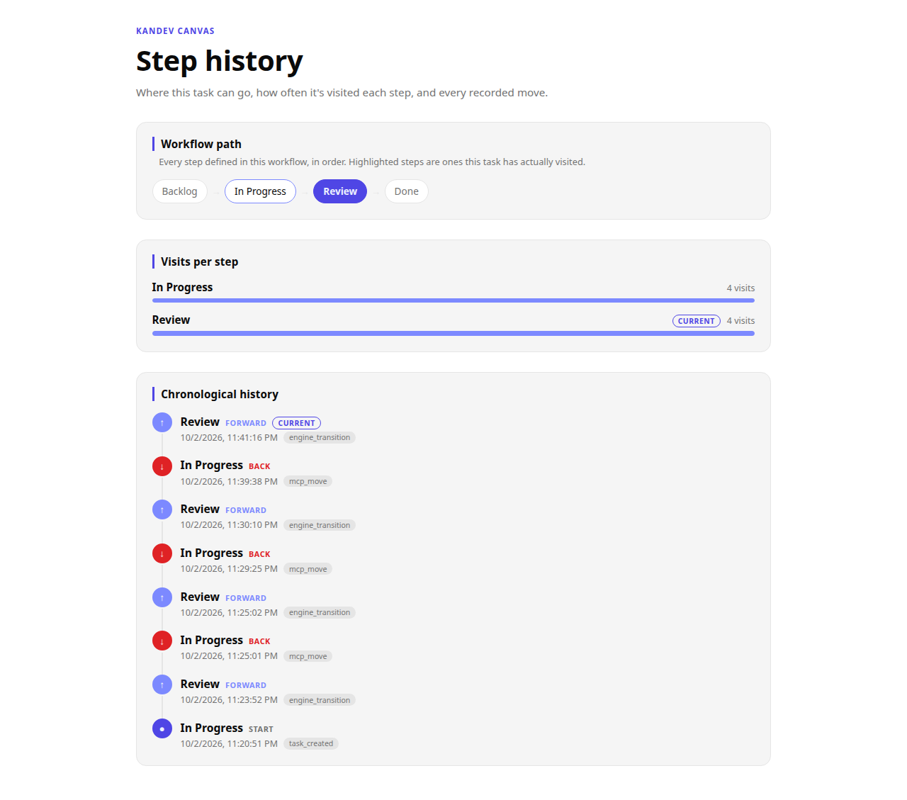

# Step History — a Kandev canvas

A read-only [Kandev canvas](https://github.com/kdlbs/kandev/blob/main/docs/public/canvases.md)
that shows a task's own recorded movement through its workflow: the
workflow's full defined step sequence as context, a per-step visit tally,
and a chronological log of every move the task has made — newest first,
forward and backward moves visually distinguished, current step flagged.

## What it shows

- **Workflow path** — every step the workflow defines, in order, as
  read-only context. Steps the task has actually visited are highlighted;
  the current step is filled solid.
- **Visits per step** — how many times the task has been moved onto each
  step, ordered by the workflow's own step order (not frequency).
- **Chronological history** — every recorded transition, newest first,
  each row showing the step it moved to, a forward/backward/entry marker,
  the timestamp, and the trigger type.

It fetches live via Kandev's `./_kandev/v1` canvas protocol
(`data/tasks/{task_id}/step-transitions` and the task's workflow steps) —
no invented data, no caching beyond the page load.

## Scope

This is a **task-scoped** canvas: per Kandev's canvas model, it reads only
the task it's attached to. It does not (and cannot) show other tasks'
histories or a workflow-wide view without promotion to workspace scope,
which this package does not request.

Declared permissions: read-only `tasks` and `workflows` data. No writes, no
shared state, no external network access.

## Install

From inside Kandev, with canvases enabled (`Settings → System → Feature
Toggles → Canvases`, or `KANDEV_FEATURES_CANVASES=true`):

- **From the marketplace:** `Settings → Plugins → Canvases → Browse`,
  search "Step History".
- **Direct install:** `Settings → Plugins → Canvases → Install canvas`,
  paste a direct link to the
  [latest release](https://github.com/sharifndlovu123/kandev-canvas-step-history/releases/latest)'s
  `step-history-<version>.tar.gz` asset, or upload it after downloading.

Installing this way creates a **workspace**-scoped canvas (Kandev's install
path always does, regardless of what the package requests) — not bound to
one task. For a canvas that reads only one specific task, have that task's
own agent build one from scratch inside Kandev, referencing this source as
a design example.

## Source

Plain static files, no build step: `manifest.yaml`, `index.html`,
`script.js`, `styles.css`, `appearance.js`. Built and iterated inside
[kandev-workflow-test](https://github.com/sharifndlovu123/kandev-workflow-test/blob/feature/canvas-conversion/docs/canvas-conversion-notes.md),
which has the full design history if you want it.

## License

MIT — see [LICENSE](LICENSE).
